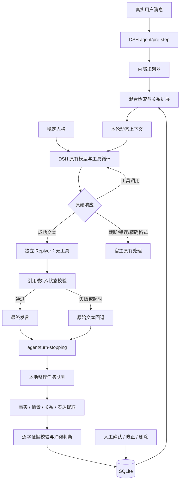

# 架构与实现边界

这是一个 DSH 原生插件：通过回合钩子、独立文本生成和本地存储接入，不运行其他聊天主程序。设计参考与历史来源见 [设计参考](../THIRD_PARTY_NOTICES.md)。

## 层次

### DSH 集成

`lib/index.js` 只负责服务接线、生命周期和受保护的本机 API。核心引擎不知道 Cordis/Web UI 的实现，存储和模型适配也彼此分离。

- `systemPrompt.section`：稳定人格，以及执行阶段接力说明（order 10300），不使用 complete 模式，不删除宿主身份、工具说明或权限规则。关闭独立 Replyer 时才回到单阶段发言约束。
- `llm/stream`：只处理已由本插件接纳的真实 Agent 回合信号。工具调用流逐块原样传递；只有 stop 的最终纯文本进入独立 Replyer。辅助调用使用派生信号，不递归进入 Replyer，不影响养鱼或其他范围外调用。
- `agent/pre-step`：先遵守宿主拒绝决定，再处理 source.kind=user 的真实用户输入；每回合规划一次，在进入步骤的消息末尾追加一条有来源标记的插件 notice，把本轮规划和记忆送入首个请求。工具步骤不重复追加，用户原文和宿主决策其他字段保持原样。
- 注入消息使用 producer-owned 来源 `source.kind=dsh-natural-dialogue`，不使用 v4 已拒绝的 `kind=plugin` 包装。原生来源测试可通过 `DSH_NATIVE_V4_SOURCE` 指向本机 codec 源码执行；它加载实际来源校验函数，验证插件生成的消息，不替代整个会话的端到端恢复测试。
- 不在 pre-step 中更新 `systemPrompt.context`：DSH 已在这个钩子前装配了上下文，更新注册器不能影响当前首个请求。这一顺序已加入回归测试。
- `agent/turn-stopping`：提交整理任务，不让整理延迟阻塞当前回复。用户输入和模型输出都保留来源，工具结果和插件注入不被当成用户自述。
- 辅助模型通过 `ctx.llm.stream` 使用宿主已有服务，无独立 API Key 存储。

本轮规划缓存以 session/turn 关联，AbortSignal 用于取消与诊断缓存，不作为未来回合的控制信号。插件 notice 会留在宿主会话历史中，文案标明只供当前回合参考；这不是硬隔离或自动删除。稳定人格与基础口吻持续生效，临时语气不靠工具步骤重新抽样。

### 规划与表达

人格资料由独立的 `lib/personas.js` 提供「日常聊天」方案，统一用于配置默认值、设置页和稳定提示词。身份、性格、关系、兴趣、价值取向、反感点、行为、表达和示例分开保存；默认角色、性格、行为、口吻与备用表达采用重新编写的文案，临时语气默认关闭；其余补充字段默认留空。规划调用接收人格资料，整理调用也接收同份资料，以约束表达候选的适用性；逐字证据仍只允许来自本轮用户原文。人格示例不进入来源表，不作为用户事实。人格更换不会切换记忆范围，也没有后台自动改写人格的机制。

规划器输出意图、主题、检索查询与交流姿态。模型失败时回退到局部确定性规划，不阻止主模型回答。规划器不控制工具权限、不代替 DSH 的工作计划或擅自忽略用户请求。

回复处理分为执行和发言两层：DSH 完成执行，工具无调用的最终文本作为 reply reference，经单独 LLM 调用组织可见发言。两层之间不增加可执行工具，边界由原生流中间件识别。Replyer 不继承宿主工具提示词或 schemas，而使用人格、近十条真实用户/助手文本（过滤含工具调用的助手消息）、本轮记忆/表达与回复参考；内部规划不传入 Replyer，多模态不在此版范围。记忆读取最终发言。

主请求遇到 tool-call 即释放已缓冲内容并透传后续流，工具 ID、参数、reasoning/replay 和 finish 保持原样；错误、截断、非文本内容、精确输出也不改写。缓冲超过约 2 MB/40000 块后透传。完整成功文本最多 30000 字符。Replyer 成功前不把草稿显示给用户，生成校验后作为一个新文本块交给宿主，因此牺牲首字延迟和逐 token 展示，避免先显示草稿再替换。

代码、链接、常见路径用一次性占位符保护，替换次数、数字集合和部分执行状态须通过校验。列表序号不算事实数字；这些确定性检查不验证所有语义，也无法证明句子间事实归属不变。超时/失败回退原文。成功替换时丢弃不再匹配内容的私有 replay 状态，合并两阶段已报告的用量（未报告的无法补算）。宿主仍记录主请求头和相同的 provider/model，回复生成细节通过插件的 Replyer 计数、成功/回退状态诊断；不是完整的双请求审计日志。

0.2.2 调整参考的语义：chat/support 且没有明确详细输出要求时，允许不采用无关引用和数字，禁止改写采用的占位符或新增数字、执行成功声明；task 和完整清单要求仍严格保留。建议字数不是硬裁剪，不保证每个模型都遵循。逐轮诊断写入本地元数据日志，记录 session/turn、模式、成功/回退原因及长度，不含正文；旧版未记录的具体回退原因无法追溯。

0.3.0 使用普通 Replyer 的消息排列：system 人格与基础表达 → 真实 user/assistant 历史 → 当前用户（按 ID 去重）→ 单独的记忆/表达/临时风格资料 → 可选回复参考 → 本轮回复目标。每条历史最多 3000 字符。历史不再以一个 JSON 对象假装多轮对话，规划 intent/stance 也不再直接传给 Replyer。人格行为由规划阶段使用，回复器使用人格和表达，避免重复塞入相同设定。任务完整性校验继续保留，未加入“禁用开场白”词表。默认温度对齐参考配置的 1，模型保持当前会话路由。

默认表达独立于临时语气。临时语气按概率仅在非工作型回合抽样一次。表达库按情境词项匹配选择候选，一次最多三条，提示主模型最多自然采用一条。

### 记忆模型

SQLite 中的 sources 是有回合身份的证据来源，items 是可被检索的记忆，jobs 是持久整理任务。源键由 namespace + session + turn 生成，兼容旧来源记录；重复钩子或重启后的同一来源不重复入库。不同记忆记录按范围、种类、主体、属性和值去重。

fact、relation、expression 默认候选审核；episode 表示对话发生过的主题摘要，自动生效，但不是外部事实证明。模型置信度只是模型自评，不能替代验证。

证据必须逐字出现在这次用户原文中；外部推断、无证据输出和明显凭据内容丢弃。同主体、同属性的新值与已生效值矛盾时，进入待确认。用户确认后原事实标记为 superseded，不在两条冲突事实中随机挑一条。手工修正生成新的人工证据，不沿用旧引文假装有依据。

人物画像目前是已确认事实的结构化集合，没有另外生成一段不可追溯的“人物总结”。关系以主体、谓词、对象形式存储于 relation 项；检索围绕种子实体做一跳扩展。

### 检索与演化

先按范围隔离并过滤非 active 条目，再融合词项逆文档频率分数、可选向量余弦分数与时间衰减。只有已配置且可用的向量会参与；向量空间记录端点、模型和维度指纹，指纹不同不混用。没有 FTS5/FAISS 或全量 ANN 索引，本版每范围最多读取 2000 条。

衰减按最近访问时间的半衰期计算，召回更新访问时间。未保护、四个半衰期未访问的生效记忆会冻结；冻结和保护均可人工恢复/切换。原始来源片段按保留天数清理，失败任务的来源在重试前保留。没有后台全库自动裁剪或不可恢复的自动删除。

### 队列、隔离与故障

每进程串行整理，最多积压 20 个内存任务。任务记录先持久化；失败最多三次，下一次相同范围的对话会拉起待处理任务。人工可重新排队。关闭自动整理后不再处理等待任务。进程退出时取消辅助调用，再关闭库。

默认同一工作区共享记忆，不同工作区隔离。全部工作区共享需要明确选择；配置值 profile 表示当前插件库共享，不代表宿主 profile 自动隔离。多个宿主 profile 需要用 directory 选项分库。养鱼 session 前缀、whale-work 目录、subagent 均排除；自定义养鱼工作目录请加入 excludedWorkspaces，轮换后的特殊会话请按实际范围检查。

SQLite 使用 sql.js 的可移植编译版本，不依赖 Electron 原生二进制 ABI。写操作保留内存备份，提交并原子替换文件；失败恢复内存状态。写入锁防止两个 DSH 进程同时操作同一库。内存库/配置异常时显示诊断并降级，不修改宿主。

### 已实现能力与边界

| 能力                   | 本版适配                                 | 尚未覆盖                               |
| ---------------------- | ---------------------------------------- | -------------------------------------- |
| Planner / Replyer 分离 | 内部交流规划 + DSH 执行 + 独立 Replyer   | 不移植群消息调度或主程序动作体系       |
| 人格与多重表达         | 稳定人格、行为、默认风格、按回合临时语气 | 一回合多条输出不会逐条独立抽样         |
| 事实、画像与证据       | 结构化事实、引文、来源、置信度、冲突审核 | 无独立画像总结/实体消歧流水线          |
| Episode                | 回合级情景摘要与可追溯来源               | 跨回合自动分段、事件重建               |
| 向量与稀疏融合         | 可选向量 + 词项得分 + 一跳关系           | ANN 索引、重排器、复杂图遍历、批量回填 |
| 记忆演化               | 访问强化、衰减、冻结、保护、恢复、删除   | 多阶段回收站/自动归档服务              |
| 表达学习               | 用户原话提炼、证据校验、审核后按情境使用 | 大规模自动学习与表达向量索引           |
| 多模态                 | 只处理真实文本用户消息                   | 图片/音频/表情包记忆                   |

当前实现文本对话的规划、回复与记忆管线，表中尚未覆盖的能力仍属于后续工作。

## 验证范围

已在隔离测试中覆盖 SQLite 持久化、冲突、修正、范围隔离、冻结、队列重试、证据约束、向量格式、按回合规划复用、关闭/降级、钩子与本机 API、设置页面渲染。

另用本机实际安装的 `@deepseek-ai/dsh-system-prompt` 0.1.5-rc.2 与 Cordis 4.0.2 做了隔离装配测试：宿主身份保留，自然对话 section 正常出现，不调用模型。没有对整个 DSH 应用、真实模型效果或长周期记忆质量做端到端验收；源码接口核对不等于完整运行兼容保证。

2026-10-26，首次时序修复阶段以 DeepSeek 做过四个单阶段样本；此后完成独立 Replyer 的 DSH 适配。当前 36 项测试覆盖首轮接入、两阶段生成、记忆读取最终回复、工具流原样传递、递归排除、取消、超时、回退、引用保护、用量合并和 replay 状态丢弃。

通过本机 DSH 的 LLM 服务，以 `deepseek-official / deepseek-flash` 做了讨论和任务结果两组真实两阶段调用：每组主请求与 Replyer 分别调用一次，两组均成功生成而未回退。使用合成资料，不导入真实聊天，不调用真实工具；输出经 DSH 原生 BlockAssembler 组装，并单独验证了合成工具块保留。这不是整个桌面 Agent 的全链路验收，也不能证明长期风格稳定或全部语义无损。临时验证入口已移除，不随正式插件启动或后台调用模型。

0.3.0 的 42 项回归测试通过。另在相同 DeepSeek 模型、温度 1、系统提示和最后回复要求下，对照 JSON 封装与真实角色轮次，各跑三轮合成对话，共六次生成正常结束。新结构第三轮能顺着用户纠正转为闲聊，但前两轮仍有“先定方向”的措辞，不能据此断言人味或风格稳定性达标。两条分支后续历史随各自输出发展，样本数量小，且不是与旧版完整提示词的严格 A/B。没有真实工具操作或社交平台发言。

## 0.3.1 边界复查

本次回归共 61 项：新增默认值迁移、设置保存冲突、UTF-8 分块、草稿保留、进程锁恢复、范围变更及辅助请求晚到结果等检查。测试使用隔离数据，真实模型的长期风格稳定性仍需使用者验证。

- 配置采用 schemaVersion 1。首次升级先备份原文件，只替换已知旧默认值，自定义姓名与文字保留；非法配置保留原文件并显示诊断。保存采用原子替换和版本冲突检测。
- 记忆确认、修正及重试刷新状态时保留未保存的人格草稿。空设置请求或非法编码不能重置配置。
- 同轮继续执行不重复注入提示；工作区范围改变后，不把前一范围的上下文写入新范围。关闭自动整理或回复器后，未完成的辅助请求不能再提交新结果。
- 记忆库不可用时保留人格与规划，并显示降级状态。Windows 使用内核命名管道锁，退出后自动释放；兼容旧 PID 锁。损坏的 PID 锁保留并拒绝写入，需要确认没有写入进程后人工处理。其他平台使用本机端口锁，端口冲突可能造成保守拒绝。
- 来源清理在整理维护时触发，不是严格的后台定时服务。记忆删除不会删除宿主聊天历史，也不代表其他条目引用的来源一并消失。

尚未覆盖的多模态记忆、跨回合事件重建、向量批量回填及复杂关系推理，仍以能力表为准。
